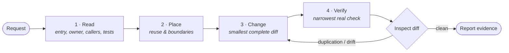

<div align="center">


<br/>

[](CHANGELOG.md)
[](evals/results-v0.2.md)
[](https://developers.openai.com/plugins/concepts/skills)
[](#repository-layout)
[](evals/fixtures/task-service)
[](#contributing)

**A lightweight, instruction-only Codex Skill that keeps AI-written changes small, reusable, and honestly verified.**

[Quick Start](#quick-start) ·
[How It Works](#how-it-works) ·
[Evidence](#evaluation-evidence) ·
[Scope](#scope--limitations) ·
[FAQ](#faq) ·
[中文文档](README.zh-CN.md)

</div>

---

> **ClearCode** is the project. **`maintainable-coding`** is the skill identifier Codex uses.
> The skill is plain Markdown — no runtime, no daemon, no CI hook, no lock-in.

## Why ClearCode?

AI coding agents are fast, but speed is not maintainability. Left unchecked, an agent can:

- ❌ **Copy a business rule** instead of reusing the one that already exists.
- ❌ **Leak provider, framework, or storage details** into business logic.
- ❌ **Invent abstractions** — factories, registries, plugin systems — for providers that do not exist yet.
- ❌ **Report “all tests pass”** without ever running a command.
- ❌ **Rewrite half the repository** to fix one boundary bug.

ClearCode is a small, focused set of instructions that steers an agent toward the opposite behavior:
**make the smallest complete change that fits the repository, then leave accurate evidence about whether it works.**

## Features

| | Feature | What it means |
| :-- | :-- | :-- |
| 🎯 | **Focused changes** | Read the entry point, owning implementation, callers, and tests — not the whole repository. |
| 🔁 | **Reuse before writing** | Search for an existing rule, helper, or adapter before adding a second copy of it. |
| 🧱 | **Boundaries that hold** | Keep provider, framework, storage, and transport details at the adapter or composition edge. |
| ✅ | **Honest verification** | Every check is reported as **passed**, **failed**, or **not run** — never inferred from reading code. |
| ⚖️ | **Proportional process** | A one-line copy fix stays a one-line fix; risky interfaces get deeper review. |
| 🛑 | **Bounded repair** | At most two focused repair rounds for the same failure, then preserve the evidence and stop. |
| 🧪 | **Measured, not marketed** | Claims are backed by replayable evaluation runs, including the cases where the skill showed no gain. |

## Quick Start

### 1. Get the skill

```bash
git clone https://github.com/11zhangzheng/ClearCode.git
```

### 2. Install it into a repository

Codex loads repository-scoped skills from `.codex/skills/<skill-name>/SKILL.md`.
From the **root of your target repository**, copy the complete skill directory:

```powershell
# Windows (PowerShell)
New-Item -ItemType Directory -Force .codex\skills | Out-Null
Copy-Item -Recurse -Force <path-to-ClearCode>\maintainable-coding .codex\skills\maintainable-coding
```

```bash
# macOS / Linux
mkdir -p .codex/skills
cp -R <path-to-ClearCode>/maintainable-coding .codex/skills/maintainable-coding
```

### 3. Use it

Start a fresh Codex chat inside that repository and invoke the skill explicitly:

```text
$maintainable-coding implement this repository change
```

The metadata also permits implicit selection for matching implementation, fix, and review requests.
Automatic selection is model- and context-dependent — **prefer explicit invocation when evaluating a specific version.**

## How It Works

ClearCode enforces a fixed working order: understand the context, decide responsibility and reuse, make the necessary change, then verify behavior and inspect the diff.



### Risk-proportional depth

Risk controls **how deep** the agent investigates — it does not control authorization.
Reversible work that was already requested continues; the skill only asks when a material choice is unresolved or an irreversible action is unapproved.

| Risk | Example | Investigation depth |
| :-- | :-- | :-- |
| 🟢 **Low** | Copy, local config, narrow fix | Read the target and closest check; make the precise change; no process documents. |
| 🟡 **Medium** | Single-module feature, business-rule change | Search existing implementations and callers; run a focused behavior check. |
| 🔴 **High** | Public interface, persistence format, dependency boundary, cross-module change | Identify affected callers and compatibility/migration needs **before** implementing. |

### The verification contract

The skill refuses to blur three very different states:

```text
Passed   → the named command ran successfully on the relevant path
Failed   → it ran and failed; include the important failure
Not run  → it was unavailable, blocked, or skipped; say why
```

Example of the report style ClearCode produces:

> Changed the boundary comparison and added the focused regression test.
> `pytest tests/test_titles.py` was **not run** because `pytest` is not installed in this environment.
> I did not claim the regression passed.

## Evaluation Evidence

This project treats evaluation as a deliverable. Each version ships with fixed prompts, a small Python fixture, and recorded baseline-vs-skill runs. **These are small-sample results, not general performance guarantees.**

### v0.1 — eight paired cases

| Metric | Baseline | With skill | Change |
| :-- | --: | --: | --: |
| Functional cases passed | 8 / 8 | 8 / 8 | — |
| Elapsed time | 589.09 s | 593.37 s | +0.7% |
| Input tokens reported | 1,041,553 | 1,253,260 | +20.3% |
| Files changed | 19 | 18 | −5.3% |
| Added / deleted lines | 206 | 169 | −18.0% |

The baseline already passed every case, so the skill did not improve the pass rate — but it produced **18% smaller diffs** at the cost of **20% more input tokens**. That trade-off drove v0.2.

### v0.2 — same behavior, ~40% less instruction

| Skill source | Lines | UTF-8 bytes | Change |
| :-- | --: | --: | --: |
| v0.1 | 136 | 6,043 | — |
| v0.2 | 82 | 3,658 | **−39.7%** lines, **−39.5%** bytes |

Five high-value regression cases (new-project structure, dependency boundaries, failed verification, low-risk copy change, intentional rule change) all passed. Against the matching no-skill baseline over the same five cases, v0.2 was **4.7% faster**, used **9.3% fewer input tokens**, changed **16.7% fewer files**, and changed **17.5% fewer lines**.

Trigger behavior was also measured: **3/3 natural** requests activated the skill without naming it, and **2/2 negative** requests (a concept question and a translation task) correctly made no repository changes.

### Why there is no v0.3 (yet)

A deterministic checker is added only when the **same rule is missed in at least two independent real tasks**. No rule crossed that threshold, so the honest decision was to ship no script rather than build a general code-analysis framework nobody asked for. See [`evals/v0.3-decision.md`](evals/v0.3-decision.md).

<sub>Full reports: [`evals/results.md`](evals/results.md) · [`evals/results-v0.2.md`](evals/results-v0.2.md) · Rubrics: [`evals/cases.md`](evals/cases.md)</sub>

## Repository Layout

```text
ClearCode/
├── maintainable-coding/          # The installable skill
│   ├── SKILL.md                  # Core instructions (82 lines)
│   ├── agents/openai.yaml        # UI metadata and triggering policy
│   ├── references/               # Loaded only when a task needs them
│   │   ├── new-project.md
│   │   └── change-review.md
│   └── examples/                 # Short reuse / over-design / verification examples
├── evals/                        # Fixed prompts, fixture, runner, and result logs
│   ├── cases.md                  # Rubrics (hidden from the evaluated run)
│   ├── fixtures/task-service/    # Dependency-free Python fixture
│   ├── prompts/                  # One prompt per case
│   ├── run-evals.ps1             # Replayable baseline vs skill runner
│   └── results*.md               # Recorded evidence
├── assets/banner.svg
├── CHANGELOG.md                  # Version history and rule-change rationale
└── README.md
```

## Scope & Limitations

ClearCode is deliberately narrow, and it says so up front:

| | |
| :-- | :-- |
| ✅ **First supported target** | Codex with small Python agent/backend repositories. |
| ✅ **Guidance** | Language-neutral where practical. |
| ⚠️ **Not claimed as tested** | Hosts or repository types other than the one above. |
| ❌ **Not permission or CI enforcement** | The skill provides no access control and no build gate. |
| ❌ **Not automatic whole-repo refactoring** | It makes focused changes, not sweeping rewrites. |
| ❌ **No independent CLI or background agent** | It is instructions, plain and simple. |

> Documentation is not a quality guarantee. The evaluation records — including the failures and the cases with no measured gain — are kept precisely so claims stay honest.

## FAQ

<details>
<summary><b>Is ClearCode a linter or a CI gate?</b></summary>

No. It is an instruction file that shapes how an agent plans and verifies a change. It has no runtime, no access control, and no build enforcement.
</details>

<details>
<summary><b>Which agents are supported?</b></summary>

Codex is the first supported target and the only one with recorded host checks. The guidance is written to be language-neutral where practical, but no other host is currently claimed as tested.
</details>

<details>
<summary><b>Why is the folder called <code>maintainable-coding</code> and not <code>ClearCode</code>?</b></summary>

`ClearCode` is the public project name. `maintainable-coding` is the stable skill identifier used in `SKILL.md` and by Codex discovery.
</details>

<details>
<summary><b>Will this slow my agent down?</b></summary>

Across the small samples recorded here, overhead stayed under the 25% trial target, and the v0.2 five-case comparison was slightly faster than the matching baseline. Treat that as a small-sample signal, not a benchmark.
</details>

<details>
<summary><b>Does it trigger automatically?</b></summary>

The metadata allows implicit invocation, but automatic selection is model- and context-dependent. For reproducible results, invoke it explicitly with `$maintainable-coding`.
</details>

<details>
<summary><b>How do I update or remove it?</b></summary>

Replace the whole `.codex/skills/maintainable-coding` directory with the new version and start a fresh chat — do not merge old and new reference files. To uninstall, delete only that directory. Your project source, tests, and other instructions are untouched.
</details>

## Contributing

Contributions and honest counter-evidence are welcome.

1. Open an issue describing the behavior you want to change **and the failure it addresses**.
2. For skill changes, add or update an evaluation case in [`evals/cases.md`](evals/cases.md) so the effect is observable.
3. Validate the package and run the dependency-free fixture suite:

   ```powershell
   python <codex-home>\skills\.system\skill-creator\scripts\quick_validate.py maintainable-coding
   $env:PYTHONPATH = "evals\fixtures\task-service\src"
   python -m unittest discover -s evals\fixtures\task-service\tests -v
   ```

4. Keep the diff focused — ClearCode should follow its own advice.

New rules must map to a concrete failure. If a shorter skill meets the need, keeping it small **is** the correct contribution.

## References

- [OpenAI — Skills concepts](https://developers.openai.com/plugins/concepts/skills)
- [OpenAI — Evaluating skills](https://developers.openai.com/blog/eval-skills)

## License

No license has been selected for this repository yet. Until one is added, the default all-rights-reserved rule applies. See [`CHANGELOG.md`](CHANGELOG.md) for version history.

<div align="center">
<sub>Built to make AI-written code easier to read, reuse, and trust.</sub>
</div>
