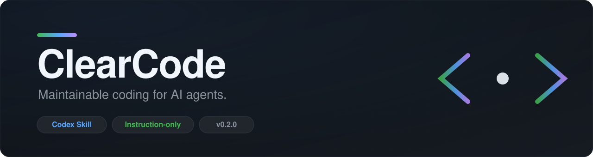
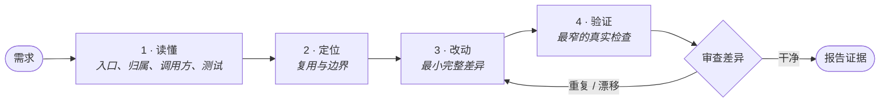

<div align="center">



<br/>

[](CHANGELOG.md)
[](evals/results-v0.2.md)
[](https://developers.openai.com/plugins/concepts/skills)
[](#仓库结构)
[](evals/fixtures/task-service)
[](#参与贡献)

**一个轻量、纯指令的 Codex Skill，让 AI 写出的改动更小、更可复用、并经过如实验证。**

[快速开始](#快速开始) ·
[工作原理](#工作原理) ·
[评测证据](#评测证据) ·
[适用范围](#适用范围与局限) ·
[常见问题](#常见问题) ·
[English](README.md)

</div>

---

> **ClearCode** 是项目名，**`maintainable-coding`** 是 Codex 使用的 Skill 标识。
> 它只是一份 Markdown 指令——没有运行时、没有常驻进程、没有 CI 钩子、没有锁定。

## 为什么需要 ClearCode？

AI 编程智能体很快，但快并不等于可维护。不加约束时，智能体可能会：

- ❌ **复制业务规则**，而不是复用已有的那一份。
- ❌ **让供应商 / 框架 / 存储细节**渗入业务逻辑。
- ❌ **臆造抽象**——为尚不存在的供应商提前搭工厂、注册表、插件系统。
- ❌ **谎报“全部测试通过”**，却从未真正运行过命令。
- ❌ **重写半个仓库**，只为修一个边界缺陷。

ClearCode 是一组小而专注的指令，把智能体引导到相反的行为：
**做出契合仓库的最小完整改动，然后留下关于它是否可用的如实证据。**

## 核心特性

| | 特性 | 含义 |
| :-- | :-- | :-- |
| 🎯 | **聚焦改动** | 只读入口、实现归属、调用方和测试——而不是整个仓库。 |
| 🔁 | **先复用再新增** | 新增代码前，先搜索已有的规则、辅助函数或适配器。 |
| 🧱 | **守得住的边界** | 把供应商、框架、存储、传输细节留在适配器或组装边缘。 |
| ✅ | **如实验证** | 每项检查都明确报告为 **通过**、**失败** 或 **未运行**，绝不靠读代码推断。 |
| ⚖️ | **按风险投入** | 一行文案修改就保持一行；高风险接口才做深度审查。 |
| 🛑 | **有界修复** | 同一失败最多两轮定向修复，随后保留证据并停止。 |
| 🧪 | **靠度量而非营销** | 结论都由可重放的评测支撑，包括那些没有带来增益的案例。 |

## 快速开始

### 1. 获取 Skill

```bash
git clone https://github.com/11zhangzheng/ClearCode.git
```

### 2. 安装到某个仓库

Codex 从 `.codex/skills/<skill-name>/SKILL.md` 加载仓库级 Skill。
在**目标仓库根目录**下，复制完整的 Skill 目录：

```powershell
# Windows (PowerShell)
New-Item -ItemType Directory -Force .codex\skills | Out-Null
Copy-Item -Recurse -Force <path-to-ClearCode>\maintainable-coding .codex\skills\maintainable-coding
```

```bash
# macOS / Linux
mkdir -p .codex/skills
cp -R <path-to-ClearCode>/maintainable-coding .codex/skills/maintainable-coding
```

### 3. 使用

在该仓库中开启一个新的 Codex 会话，并显式调用：

```text
$maintainable-coding implement this repository change
```

元数据也允许在匹配的实现、修复和审查请求中隐式选择该 Skill。
但自动选择依赖模型与上下文——**评估某个具体版本时，请优先显式调用。**

## 工作原理

ClearCode 固定了工作顺序：读懂上下文 → 判断职责与复用 → 实现必要改动 → 验证行为并审查差异。



### 按风险分级

风险决定**调查的深度**，而不是授权范围。
已获授权、可逆的工作会继续推进；只有在出现未决的关键选择，或涉及未授权的不可逆操作时，才需要询问。

| 风险 | 示例 | 调查深度 |
| :-- | :-- | :-- |
| 🟢 **低** | 文案、局部配置、小范围修复 | 读目标与最近的检查点，精确修改，不新增流程文档。 |
| 🟡 **中** | 单模块功能、业务规则调整 | 搜索已有实现与调用方，运行针对性行为检查。 |
| 🔴 **高** | 公开接口、持久化格式、依赖边界、跨模块改动 | 实现前先梳理受影响调用方与兼容 / 迁移需求。 |

### 验证契约

Skill 拒绝模糊三种截然不同的状态：

```text
通过      → 所指命令在相关路径上成功运行
失败      → 命令运行了但失败了；需附上关键失败信息
未运行    → 因不可用、被阻断或跳过；需说明原因
```

ClearCode 产出的报告风格示例：

> 修改了边界比较逻辑，并新增了针对性回归测试。
> `pytest tests/test_titles.py` **未运行**，因为当前环境未安装 `pytest`。
> 我没有声称该回归测试已通过。

## 评测证据

本项目把评测当作交付物。每个版本都附带固定提示词、一个小型 Python 样例仓库，以及记录的“基线 vs Skill”对照运行。**这些是小样本结果，不是普适的性能保证。**

### v0.1 — 八组对照案例

| 指标 | 基线 | 使用 Skill | 变化 |
| :-- | --: | --: | --: |
| 功能案例通过 | 8 / 8 | 8 / 8 | — |
| 耗时 | 589.09 s | 593.37 s | +0.7% |
| 上报输入 token | 1,041,553 | 1,253,260 | +20.3% |
| 改动文件数 | 19 | 18 | −5.3% |
| 增删行数 | 206 | 169 | −18.0% |

基线本就通过了全部案例，因此 Skill 没有提升通过率——但它让**差异缩小了 18%**，代价是**输入 token 增加 20%**。这一取舍直接推动了 v0.2。

### v0.2 — 行为不变，指令量减少约 40%

| Skill 源码 | 行数 | UTF-8 字节 | 相对 v0.1 |
| :-- | --: | --: | --: |
| v0.1 | 136 | 6,043 | — |
| v0.2 | 82 | 3,658 | **−39.7%** 行，**−39.5%** 字节 |

五个高价值回归案例（新项目结构、依赖边界、验证失败、低风险文案改动、有意的规则变更）全部通过。在同样五个案例上对比无 Skill 的基线，v0.2 **快 4.7%**、**输入 token 少 9.3%**、**改动文件少 16.7%**、**改动行数少 17.5%**。

触发行为也已度量：**3/3** 的自然表述在未点名 Skill 的情况下成功激活；**2/2** 的负例（概念问答与翻译任务）正确地没有改动任何仓库文件。

### 为什么暂时没有 v0.3

只有当**同一条规则在两个独立真实任务中被遗漏**时，才会引入确定性检查。没有任何规则跨过该阈值，因此诚实的决定是暂时不写脚本，而不是去造一个没人要的通用代码分析框架。详见 [`evals/v0.3-decision.md`](evals/v0.3-decision.md)。

<sub>完整报告：[`evals/results.md`](evals/results.md) · [`evals/results-v0.2.md`](evals/results-v0.2.md) · 评分标准：[`evals/cases.md`](evals/cases.md)</sub>

## 仓库结构

```text
ClearCode/
├── maintainable-coding/          # 可安装的 Skill
│   ├── SKILL.md                  # 核心指令（82 行）
│   ├── agents/openai.yaml        # UI 元数据与触发策略
│   ├── references/               # 仅在任务需要时加载
│   │   ├── new-project.md
│   │   └── change-review.md
│   └── examples/                 # 复用 / 反过度设计 / 验证失败示例
├── evals/                        # 固定提示词、样例仓库、运行器与结果日志
│   ├── cases.md                  # 评分标准（对被测运行隐藏）
│   ├── fixtures/task-service/    # 零依赖 Python 样例
│   ├── prompts/                  # 每个案例一个提示词
│   ├── run-evals.ps1             # 可重放的基线 vs Skill 运行器
│   └── results*.md               # 记录的证据
├── assets/banner.svg
├── CHANGELOG.md                  # 版本历史与规则变更理由
└── README.md
```

## 适用范围与局限

ClearCode 有意保持窄小，并在一开始就讲清楚：

| | |
| :-- | :-- |
| ✅ **首个支持目标** | Codex + 小型 Python Agent / 后端仓库。 |
| ✅ **指导内容** | 在可行处保持语言中立。 |
| ⚠️ **未声明为已测试** | 上述以外的宿主或仓库类型。 |
| ❌ **不提供权限或 CI 强制** | 该 Skill 不包含访问控制，也不构成构建门禁。 |
| ❌ **不做自动全仓重构** | 它只做聚焦改动，不做横扫式重写。 |
| ❌ **没有独立 CLI 或常驻智能体** | 它就是一份指令，仅此而已。 |

> 文档本身不是质量保证。评测记录——包括失败案例和没有测出增益的案例——被完整保留，正是为了让结论保持诚实。

## 常见问题

<details>
<summary><b>ClearCode 是 linter 或 CI 门禁吗？</b></summary>

不是。它是一份塑造智能体如何规划与验证改动的指令文件，没有运行时、没有访问控制、没有构建强制。
</details>

<details>
<summary><b>支持哪些智能体？</b></summary>

Codex 是首个支持目标，也是唯一有宿主检查记录的一个。指导内容在可行处保持语言中立，但目前不声明其它宿主已测试。
</details>

<details>
<summary><b>为什么文件夹叫 <code>maintainable-coding</code> 而不是 <code>ClearCode</code>？</b></summary>

`ClearCode` 是对外项目名；`maintainable-coding` 是写进 `SKILL.md`、供 Codex 发现机制使用的稳定 Skill 标识。
</details>

<details>
<summary><b>它会拖慢智能体吗？</b></summary>

在这份小样本记录中，额外开销均低于 25% 的试用目标，且 v0.2 的五案例对比略快于匹配基线。请把它当作小样本信号，而非基准结论。
</details>

<details>
<summary><b>它会自动触发吗？</b></summary>

元数据允许隐式调用，但自动选择依赖模型与上下文。为了结果可复现，请显式调用 `$maintainable-coding`。
</details>

<details>
<summary><b>如何更新或卸载？</b></summary>

用新版本整体替换 `.codex/skills/maintainable-coding` 目录，然后开启新会话——不要合并新旧参考文件。卸载时只删除该目录即可，你的项目源码、测试和其它指令都不受影响。
</details>

## 参与贡献

欢迎贡献，也欢迎诚实的不同证据。

1. 提 Issue 说明你想改变的行为，**以及它对应的失败场景**。
2. 修改 Skill 时，请在 [`evals/cases.md`](evals/cases.md) 中新增或更新评测案例，让效果可观察。
3. 校验包并运行零依赖样例测试：

   ```powershell
   python <codex-home>\skills\.system\skill-creator\scripts\quick_validate.py maintainable-coding
   $env:PYTHONPATH = "evals\fixtures\task-service\src"
   python -m unittest discover -s evals\fixtures\task-service\tests -v
   ```

4. 保持差异聚焦——ClearCode 自己也应遵守这条建议。

新规则必须对应具体失败。如果更短的 Skill 就能满足需要，那么保持精简**本身**就是正确的贡献。

## 参考

- [OpenAI — Skills 概念](https://developers.openai.com/plugins/concepts/skills)
- [OpenAI — 评测 Skills](https://developers.openai.com/blog/eval-skills)

## 许可证

本仓库尚未选择许可证。在添加之前，默认适用“保留所有权利”。版本历史见 [`CHANGELOG.md`](CHANGELOG.md)。

